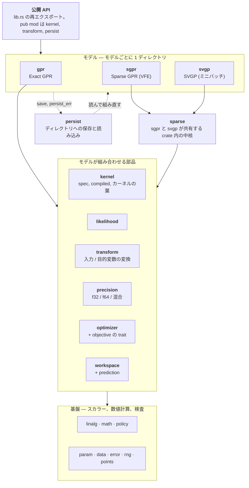
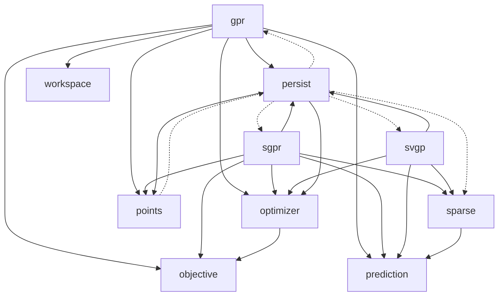
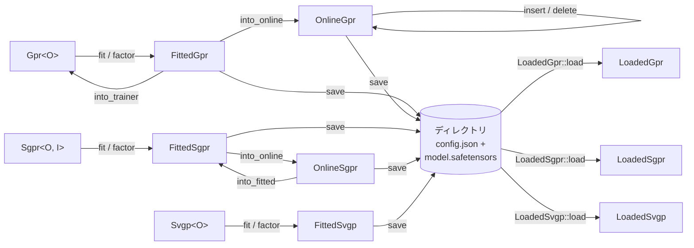

[English](architecture.md) | 日本語

# gprx のアーキテクチャ

このページはクレートの地図である。どんなモジュール（ドメイン）があり、それぞれが何を受け持ち、依存がどちらを向いているかをまとめた。ほかの事柄は、次の文書に書いてある。

- 各部品の意味と挙動: [design.ja.md](design.ja.md)
- ファイルの置き場所: [conventions.md](conventions.md)
- 決定の理由: [adr/](adr/)
- ディスクに書く形式: [persist-format.ja.md](persist-format.ja.md)

この文書が示す import（図の矢印と、表に並べたモジュール）は、`src/` の `use crate::…` から拾ったもので、`#[cfg(test)]` の中のコードは数えていない。この文書と実際の import が食い違っていないかは、スクリプトで照合している（Issue [#310](https://github.com/YUKIKEDA/gprx/issues/310)）。モジュールの import を足したり消したりしたら、同じコミットでこの文書も直すこと。

## 1. 全体像

モデルは 3 種類あり、どれも同じ部品の集まりから組み立てる。どのモデルにも学習前の型（trainer）と学習済みの型（fitted）があり、モデルによってはオンライン更新用の型もある。モデルどうしが互いを import することはない。共有したいものは、すべてモデルより下の層に置いてある。

実線の矢印は、上の層から下の層へ向かう普通の import である。破線の矢印は、層の上下関係が両方向に破られている唯一の箇所を表している。読み込みのときは `persist` がモデルを組み立て、保存のときはモデルが `persist` を呼ぶからだ。具体的にどの型と関数がこの境界を越えるのかは、4 節で挙げる。

## 2. モジュールと責務

表の「公開」は `src/lib.rs` が外に出しているもの（`pub mod` か `pub use`）、「crate」はクレートの中でだけ使うものを表す。「import 先」の列には、そのモジュールがテスト以外のコードで import している、ほかのトップレベルのモジュールを並べた。

### 基盤

| モジュール | 責務 | 公開 / 主な型 | import 先 |
| --- | --- | --- | --- |
| `error` | クレートで唯一のエラー型と、Cholesky 分解がどの処理の中で失敗したかを表す型を定義する | 公開: `GprError`, `CholeskyStage` | `param` |
| `param` | 区間で範囲を制限した正のパラメータを表し、全パラメータを 1 本に並べた `θ` へ書き込む補助関数を持つ | 公開: `Interval`, `BoundedParam`, `IntervalError` | `data`, `error`, `kernel`, `likelihood` |
| `data` | 呼び出し側から受け取ったデータの形・有限性・個数を入口で検査し、列優先に詰め直す | crate | `error`, `kernel` |
| `rng` | サンプリングと焼きなましで使う、シードつきの小さな乱数生成器 | crate: `SeededRng`（Xoshiro256++） | none |
| `math` | カーネルで使う `exp` の実装を 2 通り（厳密と高速な近似）持ち、`KernelExp` の方針でどちらを使うか選ぶ | 公開: `Accurate`, `FastApprox`, `KernelMath` | `kernel` |
| `linalg` | Cholesky 分解、LDLT 分解、三角行列の連立方程式の求解、密行列の補助関数、faer のワーカー数の上限をまとめる。モデルはこれらを自前で実装しない | crate | `error`, `kernel` |
| `policy` | 実行時に切り替える方針（距離キャッシュ、Cholesky のバッファ、カーネルの `exp`、ジッター）を定義する | 公開: `DistanceCachePolicy`, `CholeskyBuffer`, `KernelExp`, `JitterPolicy`, `FixedJitter`, `AdaptiveJitter` | `error`, `math` |
| `points` | 追加・削除される点に、変わらない id を振る | 公開: `PointId`。crate: `IdRegistry` | `error`, `persist` |

### 部品

| モジュール | 責務 | 公開 / 主な型 | import 先 |
| --- | --- | --- | --- |
| `kernel` | カーネルを記述する言語を受け持つ。組み込みのカーネルの葉と `Custom` からなる木 `KernelSpec` を、静的ディスパッチで呼べる平らな `CompiledKernel<T>` に変換し、値・勾配・Hessian・座標微分を計算する。スカラーの trait `KernelScalar` もここにある。与えられた二乗距離を読むカーネルの葉に必要なもの（スロット、`DistanceKernel` の木、呼び出し側が渡す表の結び付けと検査、学習に使う `d²` の保持）も同じモジュールに置いた（`supply.rs`、`sources/`、`compiled/supplied.rs`） | pub mod。`KernelSpec`, `CompiledKernel`, カーネルの葉（`RbfKernel`, `MaternKernel`, `PeriodicKernel`, …）, `KernelTerm`, `CustomKernel`, `KernelScalar`。`DistanceKernel`, `DistanceOnly`, `WithPoints`, `ScalarDistance`, `ArdDistance`, `DistanceSlot`, `DistanceSource`, `DistanceFill`, `ModelKernel`, `PointKernel`, `Supply`, `NoSupply` | `data`, `error`, `linalg`, `math`, `param` |
| `likelihood` | ガウスの観測ノイズ `σn²` を、ジッターとは別の独立したパラメータとして持つ | 公開: `GaussianLikelihood` | `data`, `error`, `param` |
| `transform` | 入力の変換（identity、standardize、min-max、列ごと、pipeline）と目的変数の変換を、それぞれ学習前と学習後の型で提供する。予測のときは平均と分散を元のスケールに戻す | pub mod: `Transform`, `UnfittedTransform`, `TargetTransform`, `UnfittedTarget`, `MinMaxInput`, `StandardizeTarget`, `Pipeline`, … | `data`, `error` |
| `precision` | 格納に使うスカラーと予測に使うスカラーを 1 つの方針として決め、混合精度での反復改善を行う | 公開: `PrecisionPolicy`, `DoublePrecision`, `SinglePrecision`, `MixedPrecision`, `PromoteStorage`, `ReevaluateKernel` | `error`, `kernel`, `linalg`, `math`, `policy`, `transform` |
| `workspace` | 使い回すバッファ（Gram、`W`、距離キャッシュ、`exp` のバッファ、faer の作業領域）と、クエリごとのバッファを管理する | crate: `WorkspaceCore`, `FitBuffers`, `QueryWorkspace` | `error`, `kernel`, `linalg`, `policy`, `precision` |
| `prediction` | 予測の戻り値の型を定義し、共分散から事後分布のサンプルを取り出す。`DistanceKernel` を使うモデルに共通の予測メソッドもここにある | 公開: `Prediction`, `PredictiveCovariance`, `PredictOptions`, `VarianceKind`。crate: `DistanceQuery`, `QueryPoints`, `distance_predict!` | `error`, `kernel`, `linalg`, `policy`, `rng` |
| `objective` | モデルの学習の目的関数が実装する trait を定義する。ソルバーはこの trait だけを相手にするので、モデルを知らずに済む | 公開: `Objective`, `Differentiable`, `TwiceDifferentiable`, `IncrementalObjective` | `error`, `param` |
| `optimizer` | `objective` の trait に対して動くソルバーを集める。argmin へのアダプタ、自前の焼きなまし、最適化しないことを表すマーカー型 `Fixed` がある。SVGP 用の Adam もここにあるが、これは `Optimizer` を実装しない | 公開: `Optimizer`, `Lbfgs`, `NelderMead`, `TrustRegion`, `FastSimulatedAnnealing`, `Fixed`, `Adam`, `OptResult`, `BoundaryPolicy` | `error`, `objective`, `param`, `rng` |

### モデル

| モジュール | 責務 | 公開 / 主な型 | import 先 |
| --- | --- | --- | --- |
| `gpr` | Exact GPR を実装する。`K + σn²I` を分解し、fit / refit に使う NLML とその微分、予測、共分散、サンプル、leave-one-out を計算する。LDLT 分解の因子を更新するオンラインの insert / delete も持つ。与えられた二乗距離から学習するモデルも、同じ機能を `distance.rs` で提供する | 公開: `Gpr`, `FittedGpr`, `OnlineGpr` | `data`, `error`, `kernel`, `likelihood`, `linalg`, `math`, `objective`, `optimizer`, `param`, `persist`, `points`, `policy`, `precision`, `prediction`, `transform`, `workspace` |
| `sparse` | `sgpr` と `svgp` が共有する部分をまとめる。trainer の設定、学習データ、`Z`、カーネルと尤度のパラメータを合わせた `θ`、距離から学習するモデルで呼び出し側が渡す `n × m` のブロックがここにある | crate: `SparseSpec`, `SparseCore`, `SparseSupply` | `data`, `error`, `kernel`, `likelihood`, `linalg`, `math`, `param`, `policy`, `precision`, `prediction`, `transform` |
| `sgpr` | 周辺化（collapsed）した VFE の下限で学習する Sparse GPR を実装する。誘導点 `Z` は固定にも自由にもでき、rank-1 のオンライン更新、点と誘導点の insert / delete、予測、共分散、サンプル、leave-one-out を持つ。与えられた二乗距離から学習するモデルも、同じ機能を `distance.rs` と `online/distance.rs` で提供する | 公開: `Sgpr`, `FittedSgpr`, `OnlineSgpr`, `FixedInducing`, `FreeInducing`, `InducingId` | `data`, `error`, `kernel`, `likelihood`, `linalg`, `math`, `objective`, `optimizer`, `param`, `persist`, `points`, `policy`, `precision`, `prediction`, `sparse`, `transform` |
| `svgp` | SVGP を実装する。whitened な `q(u)` と ELBO を使い、1 ステップの計算量が `n` に依らないミニバッチの Adam で学習し、予測、共分散、サンプルを計算する。与えられた二乗距離から学習するモデルも、同じ機能を `distance.rs` で提供する | 公開: `Svgp`, `FittedSvgp` | `data`, `error`, `kernel`, `likelihood`, `linalg`, `math`, `optimizer`, `param`, `persist`, `policy`, `precision`, `prediction`, `rng`, `sparse`, `transform` |
| `persist` | モデル 1 つを 1 ディレクトリ（`config.json` と `model.safetensors`）に保存し、読み込む。`Custom` のカーネルと呼び出し側が定義した変換を復元するための登録表も持つ | pub mod: `LoadedGpr`, `LoadedSgpr`, `LoadedSvgp`, `LoadedDistanceGpr`, `LoadedDistanceSgpr`, `LoadedDistanceSvgp`, `PersistRegistry`, `FORMAT_VERSION` | `error`, `gpr`, `kernel`, `optimizer`, `param`, `points`, `policy`, `precision`, `sgpr`, `sparse`, `svgp`, `transform` |
| `internals` | ベンチマークと `compare/perf` から内部を呼ぶためのフック。`bench-internals` か `insert-stages` の feature を有効にしたときだけ存在する | pub mod、feature つき | `gpr`, `kernel`, `objective` |

## 3. 部品とモデルの間の依存

基盤（`error`, `param`, `data`, `linalg`, `math`, `policy`, `rng`）はどのモジュールも使い、部品のうち `kernel`, `likelihood`, `transform`, `precision` の 4 つもほとんどのモジュールが使う。これらの矢印まで描くと図全体を横切ってしまうので、図からは省き、図の下に表で示した。各モジュールの import をすべて知りたいときは 2 節の表を見てほしい。破線の矢印は層の向きに逆らう呼び出しで、その中身は 4 節で説明する。

広く使われる 4 つの部品は、図では矢印を省いた。それぞれをどのモジュールが import しているかは次のとおり。

| 部品 | import するモジュール |
| --- | --- |
| `kernel` | `data`, `gpr`, `internals`, `linalg`, `math`, `param`, `persist`, `precision`, `prediction`, `sgpr`, `sparse`, `svgp`, `workspace` |
| `likelihood` | `gpr`, `param`, `sgpr`, `sparse`, `svgp` |
| `transform` | `gpr`, `persist`, `precision`, `sgpr`, `sparse`, `svgp` |
| `precision` | `gpr`, `persist`, `sgpr`, `sparse`, `svgp`, `workspace` |

図からは次のことが読み取れる。

- **`optimizer` と `objective` はモデルを知らない。** ソルバーは `Objective` / `Differentiable` / `TwiceDifferentiable` だけを相手に書かれており、これらの trait は各モデルが自分のアダプタ（`GprObjective`, `SgprObjective`）で実装する。利用者が自作した `Optimizer` も、組み込みのソルバーと同じ型パラメータに差し込める。
- **`sgpr` と `svgp` の接点は `sparse` だけである。** `gpr` は `sparse` を使わない。
- **`precision` と `transform` もモデルを知らない。** モデルは、方程式を `f64` で組み立てる処理をクロージャにして precision のコードに渡す。混合精度の反復改善は、残差を求めるときや `f64` での計算に切り替えるときに、このクロージャを呼ぶ。
- **最も広く使われる部品は `kernel` である。** すべてのモデルと `workspace` が使い、`persist` はカーネルの木を保存用に符号化する。

## 4. 境界と、その例外

現在のコードでは、次の境界が守られている（`#[cfg(test)]` 以外の `use crate::…` で確かめた）。

1. **モデルどうしは import しない。** `gpr`, `sgpr`, `svgp` のあいだに import は 1 つも無い。共有したいコードは 1 つ下の層に移す。2 つの Sparse モデルだけが使うなら `sparse` に、3 つのモデルすべてが使うなら部品の層に置く。
2. **モデルを import するのは `persist` だけである。** 該当するのは `persist/mod.rs`（Exact）、`persist/sparse.rs`（Sparse と SVGP）、`persist/distance.rs`（`DistanceKernel` のモデルを読み込む型）の 3 ファイルである。具体的なモデルの型をすべて import しているのはここだけなので、`LoadedGpr` / `LoadedSgpr` / `LoadedSvgp` と `LoadedDistanceGpr` / `LoadedDistanceSgpr` / `LoadedDistanceSvgp` は、精度ごとに 1 つずつ variant を持たせられる。
3. **逆向き、つまりモデルが `persist` を使う範囲は狭い。** モデルが呼ぶのは `persist::save_*` で、`gpr` だけはさらに `PersistedModel`（読み込んだ Exact モデルを組み直すための部品）と `MappedTensors`（メモリマップした `L`）も使う。`gpr`、`sgpr`、`points` は、エラーを組み立てるために `persist_err` を使う。モデルが使う `persist` の要素は、これで全部である。
4. **`optimizer`、`objective`、`precision`、`transform` はモデルを import しない。** `optimizer` の単体テストは `Gpr` を作るが、それはテストのコードの中だけの話である。
5. **`Workspace`、`QueryWorkspace`、`LltStore`、`LdltStore` と faer の型はクレートの外に出さない**（[layout の規則](../.cursor/rules/layout.mdc)）。

層がきれいに分かれていない箇所もあるが、次の 2 つは承知のうえでそのままにしている。

- **基盤のモジュールと一部の部品のあいだで、参照が循環している。** `kernel/scalar.rs` が `f32` / `f64` を表すスカラーの trait `KernelScalar` を定義し、`data`、`math`、`linalg` はこの trait についてジェネリックに書かれている。一方で `kernel` は、その 3 つをすべて使う。`param` は `KernelSpec` と `GaussianLikelihood` のパラメータを 1 本の `θ` に書き込むので両方を import し、`likelihood` はパラメータの範囲を表すために `param` を import する。`error` は `param` の `IntervalError` を包んでいる。どれも型と補助関数を参照しているだけで、実行時に呼び出しが循環するわけではない。
- **`persist` とモデルは互いを参照している。** 中身は上の 2 と 3 に書いたとおりである。

## 5. モデルごとの公開型

3 つのモデルは同じ typestate に従う。trainer から始まり、`fit`（または `factor`）を呼ぶと学習済みの値になる。学習と推論は別の型に分かれているので、学習済みの値は最適化器の状態も `W` も持たない（[design §6](design.ja.md#6-gpmodel抽象化厳密疎の差し替え)）。

| モデル | Trainer | Fitted | Online | ディスクから読んだもの |
| --- | --- | --- | --- | --- |
| Exact | `Gpr<O, P, K>` | `FittedGpr<O, P, K>` | `OnlineGpr<O, P, K>`（`insert`, `delete`） | `LoadedGpr`（8 variant）。`DistanceKernel<C>` なら `LoadedDistanceGpr<C>`（8） |
| Sparse (VFE) | `Sgpr<O, I, P, K>` | `FittedSgpr<O, I, P, K>` | `OnlineSgpr<O, P, K>`（`insert`, `delete`, `insert_inducing`, `delete_inducing`） | `LoadedSgpr`（8 variant）。`LoadedDistanceSgpr<C>`（8） |
| SVGP | `Svgp<O, P, K>` | `FittedSvgp<P, K>` | なし | `LoadedSvgp`（4 variant）。`LoadedDistanceSvgp<C>`（4） |

型パラメータの意味と、取りうる値は次のとおり。

| パラメータ | 意味 | 値 |
| --- | --- | --- |
| `O` | どの最適化器で学習するか | `Lbfgs`（Exact と Sparse の既定）, `NelderMead`, `TrustRegion`, `FastSimulatedAnnealing`, 利用者の `Optimizer`。`factor` だけなら `Fixed`。`Svgp::fit` は `Adam`（`Svgp` の既定は `Fixed`） |
| `P` | 精度。コンパイル時に決める | `DoublePrecision`（既定）, `SinglePrecision`, `MixedPrecision`（残差の計算は `PromoteStorage` か `ReevaluateKernel`） |
| `I` | 誘導点 `Z` を固定するか最適化するか | `FixedInducing`（既定。`Z` はパラメータに含めない）, `FreeInducing`（`Z` を `θ` と一緒に最適化する。座標を読むカーネルでだけ使える） |
| `K` | モデルのカーネルが何を入力として読むか。3 つのモデルで共通（[design §5.1](design.ja.md#51-仕様と評価器精度ジェネリクス)） | `KernelSpec`（既定。座標）, `DistanceKernel<DistanceOnly>`（与えられた二乗距離だけ）, `DistanceKernel<WithPoints>`（与えられた二乗距離と座標） |

## 6. モデルの状態の移り方

`DistanceKernel<C>` を使うモデルも同じ順に状態が移り、読み込みには `LoadedDistanceGpr<C>` / `LoadedDistanceSgpr<C>` / `LoadedDistanceSvgp<C>` を使う（[persist-format.ja.md 10 節](persist-format.ja.md#10-与えられた二乗距離のモデル)）。

読み込んだモデルはそのまま予測に使える。ただし最適化器の型は `Fixed` で、ハイパーパラメータを探索する最適化器は保持していない。もう一度学習したいときは、`LoadedGpr` などの variant から具体的なモデル（`FittedGpr` など）を取り出し、それに対して `with_optimizer` で最適化器を指定し、`refit` を呼ぶ。各 `save` が何を書くかは [persist-format.ja.md](persist-format.ja.md) にまとめてある。

学習と予測の処理は、いつも次の順に進む。

入力の変換 → 目的変数の変換 → `θ` を使ったカーネルと尤度の評価 → 分解 → `α` の計算 → 予測

学習済みのモデルは、渡された `X` と `y` を変換前のまま、学習済みの変換と一緒に保持している。クエリが来るたびに、その変換をあらためて適用する（[design §2](design.ja.md#2-全体アーキテクチャ概要)、[§5.5](design.ja.md#55-前処理パイプライン)）。

## 7. 何を変えるとき、どこを見るか

| 変えたいもの | 見る場所 | 一緒に変えるもの |
| --- | --- | --- |
| カーネルの葉 | `kernel/<leaf>.rs` と `kernel/compiled/` | `kernel/spec.rs`、`persist/kernel.rs`（新しい JSON のタグ）、[design §5](design.ja.md#5-カーネル設計)。詳しくは下の手順を参照 |
| すべてのモデルの最適化器 | `optimizer/` | モデルは変えなくてよい。新しい能力を表す trait が要るときだけ `objective.rs` に足す |
| Exact だけが持つ機能（オンラインの LDLT、`Gpr` の LOO） | `gpr/` | 分解の因子は `linalg/ldlt.rs` で変える |
| 2 つの Sparse モデルに共通の処理 | `sparse/` | `sgpr/` と `svgp/` はそれを呼ぶだけ |
| 精度の規則 | `precision/` | モデルの `factor/`（precision にクロージャを渡している側） |
| 保存するファイルの構成 | `persist/` | [persist-format.ja.md](persist-format.ja.md)。古いファイルを読み違えるおそれがあるなら `FORMAT_VERSION` も上げる |
| 新しいモデル | `gpr/` と並ぶ新しいディレクトリ | `persist/` に `Loaded*` 型を 1 つ足す。ほかのモデルを import してはいけない |

### 組み込みのカーネルの葉を足す

カーネルの葉の呼び分けは、実行時ではなくコンパイル時に決まる。`KernelSpec` と `CompiledKernel` の操作はどれも、カーネルの葉 1 種類につき 1 つの分岐を持つ `match` として書かれていて、その数は合わせて 40 ほどある。こうしておくと呼び出しは直接の関数呼び出しになり、コンパイラがインライン化やベクトル化をかけられる（[design §5](design.ja.md#5-カーネル設計)）。その代わり、カーネルの葉を 1 種類足すたびに、これらの `match` をすべて書き足すことになる。

書き漏らしはコンパイラが教えてくれる。結果がカーネルの葉の種類によって変わる `match` は、すべての種類を名前で列挙していてワイルドカードを使わない。だから分岐の足りない箇所は、コンパイルエラーとして一覧で出てくる。ワイルドカードが残っているのは、どのカーネルの葉に対しても正しい既定の処理（速い経路が無いときに座標から計算する）と、カーネルの葉か合成したカーネルかだけを見分ける分岐の 2 種類に限られる。

具体的な手順は次のとおり。

1. `kernel/<leaf>.rs` に本体を書く。パラメータ（`θ` とそれぞれの `Interval`）を定義し、距離または座標から値・`∂K/∂θ`・`∂²K/∂θ∂θ` を計算する処理を、正方行列、長方形行列、対角成分のそれぞれについて実装する。`FreeInducing` で誘導点を動かせるようにするなら、座標微分（`grad_wrt_coord_dim` と混合の Hessian）も実装する。座標微分を実装しないカーネルの葉では、座標微分のメソッドが `CoordGradientUnsupported` を返す。
2. `kernel/spec.rs` に `KernelSpec` の variant とその `From` を足し、コンパイラに求められた分岐を埋める。
3. `kernel/compiled/` に `CompiledKernel` の variant と、それに対応する `LeafRef` の variant（`term`）を足し、コンパイラに求められた分岐を埋める。すべてのカーネルの葉を名前で列挙している `coord_mode`、`needs_ard_sq_diff`、`needs_grad_scratch` も、ここで埋める分岐に含まれる。座標を使う計算でカーネルの葉ごとに分かれる処理は `LeafRef` のメソッドにまとめてあり、座標で評価するカーネルの木と、混合経路の両方がそれを呼ぶ。混合経路とは、与えられた二乗距離を読むカーネルの葉と座標を読むカーネルの葉が 1 つの木に混ざるとき、カーネルの葉ごとにどちらを読むかを選んで評価する経路である。
4. `persist/kernel.rs` に JSON のタグを足す。古い版で保存したファイルも、変更後に読めなければならない（[persist-format.ja.md](persist-format.ja.md)）。
5. 与えられた二乗距離も読めるカーネルの葉にするなら、さらに次の 3 つを足す。
   - `kernel/supply.rs` に、`ScalarLeafSpec` か `ArdLeafSpec` の variant、`scalar_leaf!` / `ard_leaf!` の一覧への登録、`with_distance_leaves!` への 1 組（`ScalarLeafSpec` / `ArdLeafSpec` での variant 名と、`KernelSpec` での variant 名の組）を足す。保存と読み込みで `KernelSpec` 側のカーネルの葉と対応づける処理は、この組から生成される。
   - `kernel/compiled/supplied.rs` に、`ScalarLeaf` か `ArdLeaf` の variant、compile の分岐、`each_scalar_leaf!` か `each_ard_leaf!` の 1 行を足す。組み込みのカーネルの葉はどれも同じ名前のメソッド（`apply_math`、`grad_from_sq_diff` など）を持つので、マクロに渡す処理の本体は 1 つで、すべてのカーネルの葉に使い回せる。
   - `kernel/compiled/leaf_table.rs` の `DISTANCE_LEAVES` に名前を足す。
6. `kernel/compiled/leaf_table.rs` の `leaf_index` に番号を振り（コンパイラが要求する）、表に実例を 1 つ置く。表のテストは、この実例について次の項目を検査する。
   - パラメータ
   - 座標から計算した Gram と、距離から計算した Gram
   - 異なる 2 組の点のあいだの、長方形のブロック
   - 対角成分
   - 中心差分と照合した `∂K/∂θ` と `∂²K/∂θ∂θ`
   - 座標微分
   - 保存と読み込み

   二乗距離も読めるカーネルの葉なら、与えられた二乗距離から計算した Gram と `∂K/∂θ` も検査の対象になる。
7. [design §5](design.ja.md#5-カーネル設計) を更新し、`kernel/mod.rs` と `lib.rs` に公開の再エクスポートを足す。
