## 他ライブラリとの比較

ガウス過程の論文でよく使われる回帰問題を使って、gprx を scikit-learn、GPyTorch、GPy、libgp、friedrich と比べた。最初に計算結果が一致するかを確かめ、次に予測の良さを、最後に大きなデータでも動くかを見ていく。合否を決めるテストではなく報告なので、ほかのライブラリのほうが良かった行も表に残してある。

| 段 | データ | 見るもの | gprx のモデル |
| --- | --- | --- | --- |
| T0 | Snelson 1 次元（200 点）、Mauna Loa CO₂ | 当てはまりを目で見る | `Gpr` |
| T1 | UCI。Hernández-Lobato & Adams による学習とテストの分割（各 20 通り。Boston は除く）: yacht、energy、concrete、wine (red)、power plant、kin8nm、naval | 予測の精度と、不確実性が較正されているか | `Gpr` |
| T2 | Kin40k、Protein（5 通りの分割） | 中規模データへの対応 | `Gpr`（`K` がメモリに収まるとき）、`Sgpr` / `Svgp` |
| T3 | 3DRoad、Song、Buzz、HouseElectric（`treforevans/uci_datasets`。学習 90 / テスト 10 で 10 通りの分割） | 大規模データへの対応 | `Sgpr` / `Svgp` |

どのモデルも、入力の次元ごとに別の長さスケールを持つ RBF カーネルと、ガウス分布のノイズを使う。入力と目的変数は学習データの平均と分散で標準化してある。初期値もすべて同じで、長さスケールが 1、信号の分散が 1、ノイズの分散が 0.1 である。

評価には RMSE、NLPD、95% 予測区間の被覆率を使う。RMSE は予測の誤差を、NLPD は予測分布の対数損失を測り、被覆率はテスト点のうち 95% 予測区間に入ったものの割合を表す。値は `y` のもとの単位に戻し、学習とテストの分割ごとに求めた値の平均と標準誤差を示す。

比較に入る前に、ハイパーパラメータを 1 組に固定し、学習はさせずに全ライブラリで評価した（`just perf-real-check`）。負の対数周辺尤度、RMSE、NLPD は 1e-6 以内で一致する。つまり学習後に出る差は、目的関数ではなく最適化の違いから生じている。誘導点を使うモデルにも同じ確認をしており、周辺尤度の下限は gprx、GPyTorch、GPy で等しかった。こちらは `just perf-real-full` の中で yacht に対して実行し、数値は画面に表示するだけでコミットはしていない。GPyTorch だけはテスト点の分散を独自の低ランクの式で計算するため、パラメータと誘導点が同じでも RMSE と NLPD が他の 2 つと少し異なる。ずれは 1% 未満である。

### 学習時間は最適化器で変わる

学習にかかる時間は、行列計算と同じくらい最適化器にも左右される。そのため表の各行には、どの設定で学習したかと、尤度と勾配をまとめて計算した回数を記録した。

設定は次の 2 通りである。

- ライブラリの既定：各ライブラリに最初から入っている設定のまま学習する。
- 揃えた設定：目的関数と勾配は各ライブラリのものをそのまま使い、反復の上限を 100 回、勾配の収束判定の許容値を √ε、履歴の長さを 10 に揃える。最適化のプログラムまで同じにしたわけではない。gprx は argmin の L-BFGS と More–Thuente の直線探索を使っており、揃えた上限はもともと gprx の既定値になっている。scikit-learn、GPyTorch、GPy では、scipy の L-BFGS-B に同じ上限を渡した。libgp には RProp しかなく、RProp は勾配の許容値を受け取れない。ミニバッチのモデルについては、数十万点のデータで学習を終えられる Adam の既定設定がどのライブラリにもないため、学習率 0.01、バッチサイズ 1024、データ 3 周に固定した。

評価回数が違う行どうしでは、学習時間の差を速さの差とはみなさない。メモリのピークは、プロセス全体の常駐メモリが最も大きくなったときの値である。メモリ使用量が時間とともにどう変わるかは、結果の節の図に載せた。

### インターフェース

各ライブラリで同じ回帰を書くと、次のようになる。どれも ARD RBF カーネルでハイパーパラメータを学習し、予測の平均と、ノイズを含めた観測の分散を求めて、NLPD を計算する。そのまま実行できるファイルは [`compare/perf/real/snippets/`](https://github.com/YUKIKEDA/gprx/blob/main/compare/perf/real/snippets/) にある。

<!-- snippets:begin -->
<details><summary>gprx</summary>

```rust
let kernel = KernelSpec::from(ConstantKernel::new(1.0)?)
    * KernelSpec::from(RbfArdKernel::new(&vec![1.0; d])?);
let fitted = Gpr::new(kernel, GaussianLikelihood::new(0.1)?)
    .fit(&x, n, d, &y) // L-BFGS on the negative log marginal likelihood
    .map_err(|(_, e)| e)?;
let pred = fitted.predict(&xs, m, d)?; // variance includes the noise
let nlpd = (0..m)
    .map(|i| {
        let (v, e) = (pred.variance[i], ys[i] - pred.mean[i]);
        0.5 * (2.0 * std::f64::consts::PI * v).ln() + 0.5 * e * e / v
    })
    .sum::<f64>()
    / m as f64;
```

</details>

<details><summary>scikit-learn</summary>

```python
kernel = ConstantKernel(1.0) * RBF([1.0] * d) + WhiteKernel(0.1)
gp = GaussianProcessRegressor(kernel).fit(x, y)
mean, std = gp.predict(xs, return_std=True)  # std includes the noise
nlpd = np.mean(0.5 * np.log(2 * np.pi * std**2) + 0.5 * (ys - mean) ** 2 / std**2)
```

</details>

<details><summary>GPyTorch</summary>

```python
class ExactGP(gpytorch.models.ExactGP):
    def __init__(self, x, y, likelihood):
        super().__init__(x, y, likelihood)
        self.mean_module = gpytorch.means.ZeroMean()
        self.covar_module = gpytorch.kernels.ScaleKernel(gpytorch.kernels.RBFKernel(ard_num_dims=d))

    def forward(self, x):
        return gpytorch.distributions.MultivariateNormal(self.mean_module(x), self.covar_module(x))


likelihood = gpytorch.likelihoods.GaussianLikelihood().double()
model = ExactGP(x, y, likelihood).double()
model.train(); likelihood.train()
mll = gpytorch.mlls.ExactMarginalLogLikelihood(likelihood, model)
optimizer = torch.optim.Adam(model.parameters(), lr=0.1)  # there is no default optimizer
for _ in range(50):
    optimizer.zero_grad()
    loss = -mll(model(x), y)
    loss.backward()
    optimizer.step()
model.eval(); likelihood.eval()
with torch.no_grad():
    pred = likelihood(model(xs))  # the observation distribution
    mean, var = pred.mean, pred.variance
nlpd = torch.mean(0.5 * torch.log(2 * torch.pi * var) + 0.5 * (ys - mean) ** 2 / var)
```

</details>

<details><summary>GPy</summary>

```python
kernel = GPy.kern.RBF(d, variance=1.0, lengthscale=[1.0] * d, ARD=True)
model = GPy.models.GPRegression(x, y[:, None], kernel)
model.Gaussian_noise.variance = 0.1
model.optimize()
mean, var = model.predict(xs)  # includes the noise
nlpd = np.mean(0.5 * np.log(2 * np.pi * var) + 0.5 * (ys[:, None] - mean) ** 2 / var)
```

</details>

<details><summary>libgp</summary>

```cpp
libgp::GaussianProcess gp(d, "CovSum ( CovSEard, CovNoise)");
Eigen::VectorXd loghyper(d + 2);  // log ell (d of them), log sf, log sn
loghyper << 0.0, 0.0, 0.0, 0.0, std::log(std::sqrt(0.1));
gp.covf().set_loghyper(loghyper);
for (int i = 0; i < n; ++i) {  // add_patterns(x, y) would read strided rows
    std::vector<double> row(d);
    for (int j = 0; j < d; ++j) row[j] = x(i, j);
    gp.add_pattern(row.data(), y(i));
}
libgp::RProp rprop;  // libgp's optimizer: resilient backpropagation
rprop.init();
rprop.maximize(&gp, 100, false);
const Eigen::MatrixXd pred = gp.predict(xs, true);  // mean, latent variance
const double noise = std::exp(2.0 * gp.covf().get_loghyper()(d + 1));
double nlpd = 0.0;
for (int i = 0; i < m; ++i) {
    const double v = pred(i, 1) + noise, e = ys(i) - pred(i, 0);
    nlpd += 0.5 * std::log(2.0 * M_PI * v) + 0.5 * e * e / v;
}
nlpd /= m;
```

</details>
<!-- snippets:end -->

比較のコードは、libgp の 2 つの挙動に合わせて書いてある。一つは、`predict` が返す分散にノイズが含まれないことである。もう一つは、点を一括で追加する `add_patterns(x, y)` が列優先の行列を行として読むことである。そのため、この関数が正しく動くのは次元が 1 のときに限られる。

### 機能

`✓` は、この段落の最後に挙げる版のソースか文書でその機能を確認できたことを、`—` は確認できなかったことを表す。`—` は、拡張パッケージで補えるかどうかまで調べた結果ではない。調べた版は scikit-learn 1.6.1、GPyTorch 1.15.2、GPy 1.14.2、libgp `f4a2fb7`、friedrich 0.6.0 である。

| | gprx | scikit-learn | GPyTorch | GPy | libgp | friedrich |
| --- | --- | --- | --- | --- | --- | --- |
| 言語 | Rust | Python | Python (PyTorch) | Python | C++ (Eigen) | Rust |
| ARD RBF カーネル | ✓ | ✓ | ✓ | ✓ | ✓ | — |
| カーネルの和・積 | ✓ | ✓ | ✓ | ✓ | ✓ | ✓ |
| 誘導点つきの疎 GP | ✓ `Sgpr` | — | ✓ `InducingPointKernel` | ✓ `SparseGPRegression` | — | — |
| ミニバッチの SVGP | ✓ `Svgp`（Adam） | — | ✓ | クラスのみ。ミニバッチのループは無い | — | — |
| 最初から学習し直さずに学習点を追加する | ✓ `OnlineGpr` / `OnlineSgpr` | — | ✓ `get_fantasy_model` | — | ✓ `add_pattern` | ✓ `add_samples` |
| 学習点を消す | ✓ `OnlineGpr` / `OnlineSgpr` | — | — | — | — | — |
| 事後サンプル | ✓ `sample` | ✓ `sample_y` | ✓ | ✓ `posterior_samples` | — | ✓ `sample_at` |
| f32 / 混合精度 | ✓ | — | ✓ | — | — | — |
| 学習済みモデルの保存と読み込み | ✓ | ✓ pickle / joblib | ✓ `state_dict` | ✓ `save_model` | ✓ `write` | ✓ serde |
| 最適化器の差し替え | ✓ `Optimizer` | ✓ callable | ✓ 任意の torch 最適化器 | ✓ `optimizer=` | ✓ `RProp` / `CG` | — |

### 結果

この節の数値は、1 台の PC で、すべてのライブラリを同じ学習設定にして 1 回比較したときのものである。

全学習点を使うモデル（Exact GP）と、誘導点を 512 個にしたモデル（SGPR）は、L-BFGS で最大 100 回反復する。ミニバッチのモデルは Adam で学習し、学習率は 0.01、1 回に使う点は 1024 個、データは 3 周する。gprx の L-BFGS は既定値がもともとこの上限なので既定のまま使ったが、ほかのライブラリはどれも、最初から入っている最適化の設定では学習していない。

全学習点のモデルで扱ったデータは Snelson、Mauna Loa、yacht、energy である。誘導点 512 個のモデルでは、wine、power plant、naval を 20 通りの分割、kin40k を 5 通りの分割、3droad と song を 1 通りの分割で測った。ミニバッチのモデルには kin40k、3droad、song、HouseElectric を使い、どれも 1 通りの分割である。

表の列は次のように読む。RMSE は予測の誤差、NLPD は予測分布の対数損失で、どちらも小さいほど良い。95% 区間の列は、その区間に入ったテスト点の割合である。学習 [秒] は学習にかかった実測時間である。評価回数は、尤度と勾配をまとめて計算した回数である。反復の列は最適化器自身が数えた反復回数で、gprx の行は N/A になっている。評価 1 回あたり [ms] は、学習時間を評価回数で割った値の中央値である。負の対数周辺尤度は学習を終えた時点の値を、メモリはプロセスツリー全体で常駐メモリが最も大きくなったときの値を示す。

学習時間の差を速さの差として読んでよいのは、評価回数が一致している行だけである。

誘導点を使うモデルで song を学習すると、gprx の NLPD が GPyTorch や GPy の値と食い違っている。また power plant では、GPy の予測が一部の分割で破綻しているため、GPy の RMSE と NLPD の平均は当てはまりの良さを測る値として使えない。

図は表のあとに続く。各図の直前に、その図が何を示すかを書いた。

<!-- bench:begin -->
測定に使った CPU は Intel64 Family 6 Model 191 Stepping 2, GenuineIntel である。論理 CPU は 16 個、メモリは 47.8 GiB、OS は Windows-11-10.0.26200-SP0 だった。Python のライブラリの版は scikit-learn 1.6.1、gpytorch 1.15.2、GPy 1.14.2、torch 2.14.0、scipy 1.18.1 である。gprx が使う argmin は 0.11.0、libgp はコミット f4a2fb7d を使った。

| ライブラリ | 既定の最適化 | 条件を揃えた最適化 | 探索する量 | 範囲 |
| --- | --- | --- | --- | --- |
| gprx | argmin 0.11 の LBFGS と MoreThuente の直線探索。履歴の長さ 10、反復は最大 100 回、勾配ノルムの許容値 sqrt(eps) | 既定と同じ呼び出し。gprx の既定値が、揃えた設定とすでに一致している | 各区間の中での log θ のロジット。探索に制約はかからない | ℓ、信号の分散、ノイズの分散のそれぞれに (1e-5, 1e5) |
| sklearn | scipy minimize の L-BFGS-B を optimizer='fmin_l_bfgs_b' で呼ぶ。設定は scipy の既定値（maxiter 15000、ftol 2.2e-9、gtol 1e-5、maxcor 10、maxls 20） | scipy の L-BFGS-B。maxiter 100、gtol sqrt(eps)、ftol 0、maxcor 10。目的関数と勾配はそのライブラリ自身のものを使う | log θ | ℓ、定数カーネルの値、ノイズの大きさのそれぞれに (1e-5, 1e5)（カーネルの既定値） |
| gpytorch | torch.optim.Adam、学習率 0.1、50 ステップ（Exact GP のチュートリアルの設定。GPyTorch には既定の最適化器が無い） | scipy の L-BFGS-B。maxiter 100、gtol sqrt(eps)、ftol 0、maxcor 10。目的関数と勾配はそのライブラリ自身のものを使う。勾配は -mll × n を autograd で微分して求める | softplus を通す前の生のパラメータ | ノイズは 1e-5 以上（この比較で設定した。GPyTorch の既定は 1e-4）。ℓ と outputscale には、正であることだけを課す |
| gpy | model.optimize()。paramz の opt_lbfgsb が scipy の fmin_l_bfgs_b を maxfun = maxiter = 1000、factr 1e7、pgtol 1e-5 で呼ぶ | scipy の L-BFGS-B。maxiter 100、gtol sqrt(eps)、ftol 0、maxcor 10。目的関数と勾配はそのライブラリ自身のものを使う | 各パラメータの softplus（Logexp） | 正であることだけを課し、上限は無い |
| libgp | RProp（resilient backpropagation）、100 回反復、eps_stop 0、Delta0 0.1、Deltamin 1e-6、Deltamax 50、eta- 0.5、eta+ 1.2。途中で尤度が最も高かったときのパラメータを残す | 対象外。libgp の最適化器は RProp と CG だけで、RProp は勾配の許容値を受け取らない | log ℓ、log sf、log sn（分散ではなく、振幅と標準偏差） | なし |
| friedrich | 対象外。ARD カーネルが無い | 対象外。ARD カーネルが無い | - | - |

#### 全学習点を使うモデル（Exact GP）

| データセット | ライブラリ | 学習とテストの分割 | RMSE | NLPD | 95% 区間 | 学習 [秒] | 評価回数 | 反復回数 | 評価 1 回あたり [ms] | 負の対数周辺尤度 | メモリ [MiB] |
| --- | --- | --- | --- | --- | --- | --- | --- | --- | --- | --- | --- |
| energy | gprx | 20/20 | 0.4796 ± 0.014 | 0.6993 ± 0.033 | 0.923 ± 0.0067 | 1.283 ± 0.013 | 116 ± 0.58 | N/A | 10.94 | -1013 ± 2.5 | 47.3 |
| energy | sklearn | 20/20 | 0.4773 ± 0.013 | 0.692 ± 0.029 | 0.924 ± 0.0077 | 10.26 ± 0.79 | 94.3 ± 7.1 | 53 ± 5.6 | 108.1 | -973.3 ± 6.1 | 225.1 |
| energy | gpytorch | 20/20 | 0.4773 ± 0.012 | 0.6894 ± 0.031 | 0.921 ± 0.0082 | 1.614 ± 0.036 | 111 ± 1.8 | 96.8 ± 1.6 | 14.2 | -968.5 ± 7.4 | 316.2 |
| energy | gpy | 20/20 | 0.4756 ± 0.013 | 0.6859 ± 0.031 | 0.923 ± 0.0075 | 10.24 ± 0.23 | 119 ± 2.7 | 99.2 ± 0.8 | 85.45 | -972 ± 7.6 | 245.9 |
| maunaloa | gprx | 1/1 | 8.749 | 4.838 | 0.358 | 1.484 | 130 | N/A | 11.41 | -1479 | 70.6 |
| maunaloa | sklearn | 1/1 | 8.495 | 4.856 | 0.369 | 16.54 | 120 | 100 | 137.8 | -1479 | 176.5 |
| maunaloa | gpytorch | 1/1 | 8.649 | 4.98 | 0.339 | 2.733 | 118 | 100 | 23.16 | -1479 | 522.9 |
| maunaloa | gpy | 1/1 | 8.717 | 5.072 | 0.332 | 17.98 | 116 | 100 | 155 | -1479 | 408.0 |
| snelson | gprx | 1/1 | N/A | N/A | N/A | 0.02802 | 23 | N/A | 1.218 | 89.81 | 11.5 |
| snelson | sklearn | 1/1 | N/A | N/A | N/A | 0.3259 | 126 | 18 | 2.587 | 89.81 | 109.8 |
| snelson | gpytorch | 1/1 | N/A | N/A | N/A | 0.1444 | 55 | 20 | 2.626 | 89.81 | 282.3 |
| snelson | gpy | 1/1 | N/A | N/A | N/A | 0.3382 | 50 | 19 | 6.765 | 89.81 | 142.4 |
| yacht | gprx | 20/20 | 0.7522 ± 0.081 | 1.01 ± 0.14 | 0.927 ± 0.009 | 0.8274 ± 0.11 | 327 ± 51 | N/A | 2.655 | -338.2 ± 20 | 13.9 |
| yacht | sklearn | 20/20 | 0.936 ± 0.074 | 1.411 ± 0.059 | 0.945 ± 0.0094 | 1.093 ± 0.079 | 89 ± 5.3 | 44.5 ± 1.6 | 11.58 | -270.2 ± 1.7 | 124.4 |
| yacht | gpytorch | 20/20 | 0.4157 ± 0.056 | 0.2 ± 0.099 | 0.916 ± 0.013 | 0.4499 ± 0.03 | 108 ± 6.5 | 68 ± 5.9 | 3.835 | -451.2 ± 27 | 287.3 |
| yacht | gpy | 20/20 | 0.3931 ± 0.055 | 0.1971 ± 0.1 | 0.91 ± 0.014 | 2.575 ± 0.14 | 120 ± 6 | 78.1 ± 4.7 | 21.12 | -460.6 ± 27 | 151.4 |

#### 誘導点 512 個のモデル（SGPR）

| データセット | ライブラリ | 学習とテストの分割 | RMSE | NLPD | 95% 区間 | 学習 [秒] | 評価回数 | 反復回数 | 評価 1 回あたり [ms] | 負の対数周辺尤度 | メモリ [MiB] |
| --- | --- | --- | --- | --- | --- | --- | --- | --- | --- | --- | --- |
| 3droad | gprx | 1/1 | 8.823 | 3.597 | N/A | 5230 | 788 | N/A | 6637 | N/A | N/A |
| 3droad | gpytorch | 1/1 | 8.823 | 3.597 | N/A | 1694 | 129 | N/A | 1.314e+04 | N/A | N/A |
| 3droad | gpy | 1/1 | 8.823 | 3.597 | N/A | 3970 | 135 | N/A | 2.941e+04 | N/A | N/A |
| kin40k | gprx | 5/5 | 0.2863 ± 0.0029 | 0.1634 ± 0.0083 | 0.964 ± 0.0028 | 273.4 ± 96 | 394 ± 1.3e+02 | N/A | 681.8 | 1.039e+04 ± 59 | 890.7 |
| kin40k | gpytorch | 5/5 | 0.2865 ± 0.0028 | 0.1634 ± 0.0079 | 0.964 ± 0.0028 | 73.99 ± 4.9 | 86.4 ± 5.6 | 43 ± 2.3 | 854.9 | 1.039e+04 ± 59 | 1746.8 |
| kin40k | gpy | 5/5 | 0.2863 ± 0.0029 | 0.1634 ± 0.0083 | 0.964 ± 0.0028 | 231.8 ± 42 | 88 ± 16 | 42.4 ± 2.8 | 2643 | 1.039e+04 ± 59 | 1820.1 |
| naval | gprx | 20/20 | 1.582e-05 ± 1.1e-07 | -8.994 ± 0.00076 | 1 | 56.39 ± 8.8 | 252 ± 38 | N/A | 220.7 | -5.084e+04 ± 1.4 | 288.1 |
| naval | gpytorch | 20/20 | 1.707e-05 ± 4.4e-07 | 3784 ± 5.9e+02 | 0.419 ± 0.052 | 22.54 ± 1.3 | 82.8 ± 5 | 37.9 ± 3.8 | 272.7 | -5.075e+04 ± 20 | 745.1 |
| naval | gpy | 20/20 | 1.571e-05 ± 6e-07 | -9.681 ± 0.0095 | 0.94 ± 0.0036 | 72.17 ± 5.3 | 71.5 ± 5.3 | 7.65 ± 0.99 | 1021 | -5.624e+04 ± 63 | 675.9 |
| power_plant | gprx | 20/20 | 3.775 ± 0.039 | 2.752 ± 0.01 | 0.957 ± 0.0016 | 55.88 ± 8.6 | 309 ± 46 | N/A | 178 | -377 ± 11 | 232.3 |
| power_plant | gpytorch | 20/20 | 3.777 ± 0.04 | 2.753 ± 0.011 | 0.957 ± 0.0016 | 18.94 ± 1.4 | 82.8 ± 5 | 33.5 ± 0.87 | 222.3 | -377 ± 11 | 652.0 |
| power_plant | gpy | 20/20 | 3.097e+13 ± 3.1e+13 | 3.312e+40 ± 3.3e+40 | 0.958 ± 0.0026 | 54.58 ± 2.5 | 79.8 ± 3.5 | 33.6 ± 1.3 | 666.6 | -7.044e+45 ± 7e+45 | 570.0 |
| song | gprx | 1/1 | 0.5741 | 6.122 | N/A | 31.96 | 26 | N/A | 1229 | N/A | N/A |
| song | gpytorch | 1/1 | 0.5741 | 0.8639 | N/A | 579.9 | 47 | N/A | 1.234e+04 | N/A | N/A |
| song | gpy | 1/1 | 0.5741 | 0.8639 | N/A | 6355 | 47 | N/A | 1.352e+05 | N/A | N/A |
| wine_red | gprx | 20/20 | 0.6279 ± 0.0082 | 0.951 ± 0.014 | 0.939 ± 0.0048 | 10.78 ± 2.9 | 226 ± 56 | N/A | 45.09 | 1687 ± 2 | 63.5 |
| wine_red | gpytorch | 20/20 | 0.6276 ± 0.0082 | 0.9506 ± 0.014 | 0.939 ± 0.0047 | 6.03 ± 0.13 | 114 ± 0.82 | 100 | 51.29 | 1688 ± 2 | 376.5 |
| wine_red | gpy | 20/20 | 0.6275 ± 0.0082 | 0.9504 ± 0.014 | 0.94 ± 0.0048 | 22.8 ± 1 | 112 ± 3.1 | 97.3 ± 2.7 | 196.3 | 1688 ± 2 | 299.8 |

#### ミニバッチで学習するモデル（SVGP）

| データセット | ライブラリ | 学習とテストの分割 | RMSE | NLPD | 95% 区間 | 学習 [秒] | 評価回数 | 反復回数 | 評価 1 回あたり [ms] | 負の対数周辺尤度 | メモリ [MiB] |
| --- | --- | --- | --- | --- | --- | --- | --- | --- | --- | --- | --- |
| 3droad | gprx | 1/1 | 11.18 | 3.834 | 0.948 | 34.49 | 1.15e+03 | N/A | 30.02 | N/A | 6236.7 |
| 3droad | gpytorch | 1/1 | 11.16 | 3.832 | 0.944 | 42.93 | 1.15e+03 | 1.15e+03 | 37.36 | N/A | 1284.3 |
| houseelectric | gprx | 1/1 | 0.05622 | -1.457 | 0.946 | 176.5 | 5.41e+03 | N/A | 32.65 | N/A | 29590.8 |
| houseelectric | gpytorch | 1/1 | 0.05872 | -1.419 | 0.945 | 203 | 5.41e+03 | 5.41e+03 | 37.55 | N/A | 5508.9 |
| kin40k | gprx | 1/1 | 0.6087 | 0.9093 | 0.921 | 3.181 | 108 | N/A | 29.45 | N/A | 638.8 |
| kin40k | gpytorch | 1/1 | 0.5975 | 0.8712 | 0.939 | 4.912 | 108 | 108 | 45.48 | N/A | 457.7 |
| song | gprx | 1/1 | 0.4669 | 0.6575 | 0.947 | 57.79 | 1.36e+03 | N/A | 42.53 | N/A | 8650.4 |
| song | gpytorch | 1/1 | 0.4709 | 0.666 | 0.954 | 55.96 | 1.36e+03 | 1.36e+03 | 41.17 | N/A | 3769.8 |

点の色と形は、どの図でも同じライブラリを表す。青丸が gprx、橙の四角が scikit-learn、緑の三角が GPyTorch、黄の菱形が GPy である。

**予測の誤差（Exact GP）**

列はデータセットごとに分かれている。上段が RMSE、下段が NLPD で、どちらも小さいほど良い。点の形がライブラリを表し、縦棒は分割ごとの値から求めた標準誤差を表す。Snelson にはテスト点が無いので、その列は空になっている。

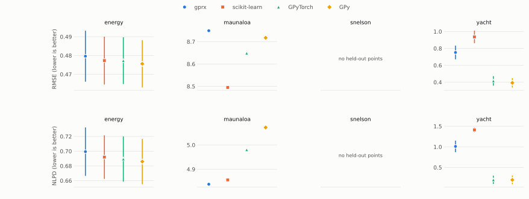

**学習の時間（Exact GP）**

上段は学習にかかった秒数を、下段はライブラリが尤度とその勾配をまとめて計算した回数を示す。どちらの軸も対数目盛りである。秒数を比べてよいのは、回数が揃っている場合だけである。

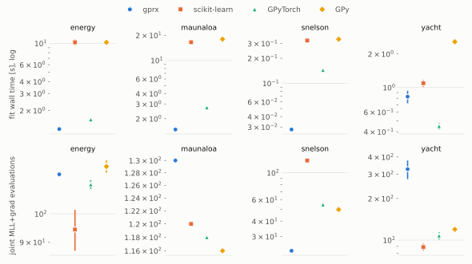

**予測の誤差（SGPR）**

読み方は Exact GP の誤差の図と同じで、上段が RMSE、下段が NLPD である。モデルの誘導点は 512 個である。

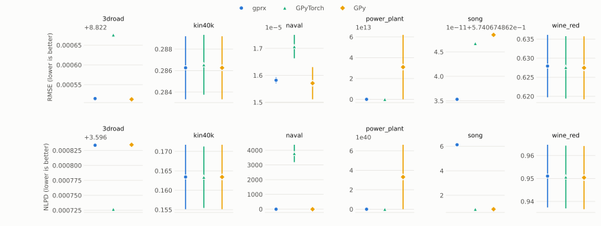

**学習の時間（SGPR）**

読み方は Exact GP の時間の図と同じである。上段が秒数、下段が尤度と勾配をまとめて計算した回数である。

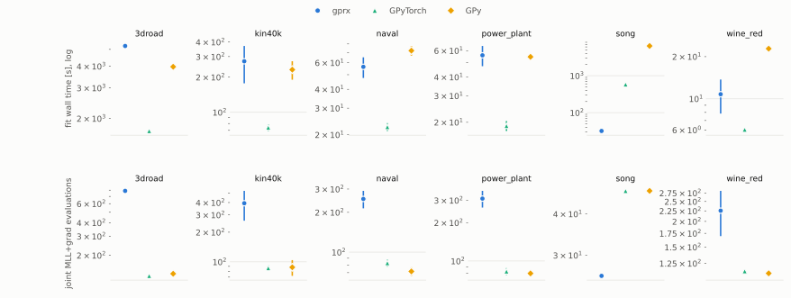

**予測の誤差（SVGP）**

gprx と GPyTorch のどちらも、Adam を学習率 0.01、バッチ 1024 で使い、データを 3 周させて学習した。GPy にはミニバッチで学習する仕組みが無いので、図に入っていない。上段が RMSE、下段が NLPD である。

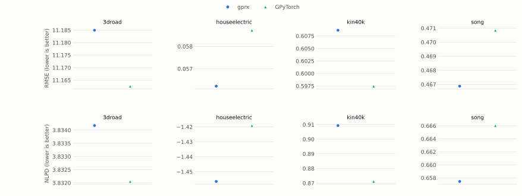

**学習の時間（SVGP）**

上段が秒数、下段が Adam の更新回数である。更新回数が揃っているので、秒数の差がそのまま速さの差になる。

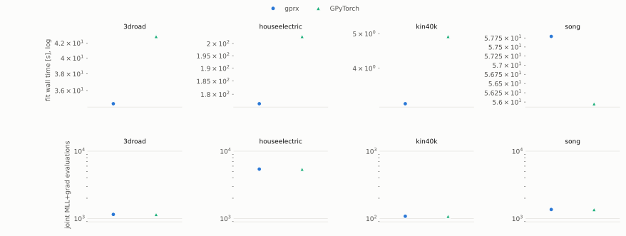

**メモリの推移（energy）**

線はプロセス全体の常駐メモリを表す。横軸は、プロセスが始まってからの秒数である。点線は各ライブラリの色で描いてあり、そのライブラリが学習または予測を始めた時刻を示す。図は 0 番目の分割で測った。

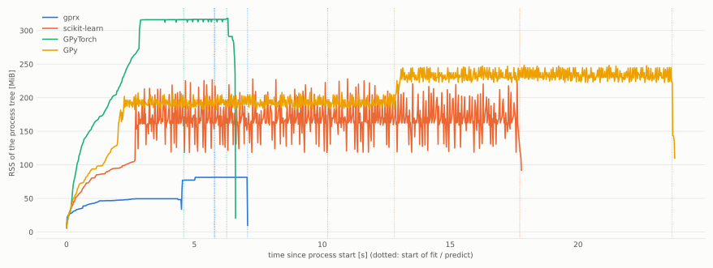

**メモリの推移（kin40k）**

読み方は energy のメモリの図と同じである。モデルは誘導点 512 個の SGPR である。図は 0 番目の分割で測った。

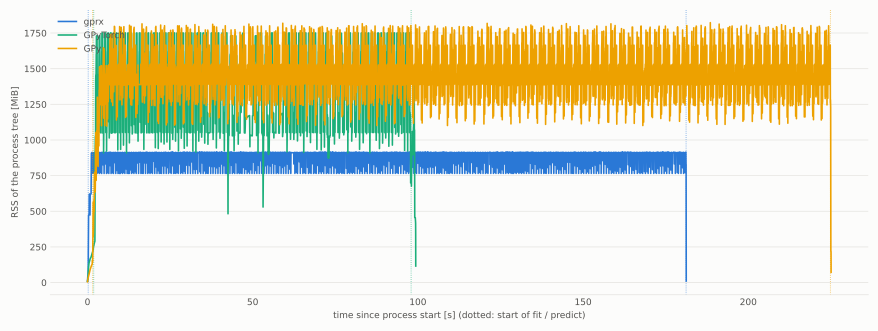

**Mauna Loa の予測**

ライブラリごとに枠を分けて描いた。線は予測の平均を、帯は 95% 区間を表す。塗りつぶした点は学習データで、白抜きの点は学習に使わずに残した点である。

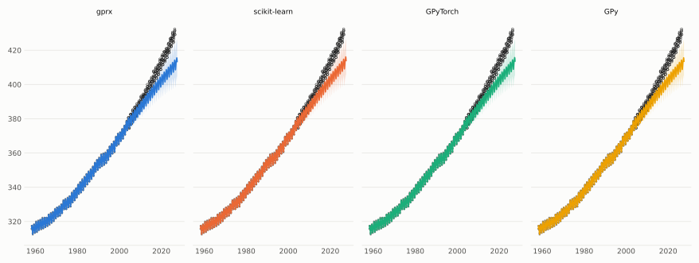

**Snelson の予測**

ライブラリごとに枠を分けて描いた。線は予測の平均を、帯は 95% 区間を表す。点は学習データで、学習に使わずに残した点は無い。

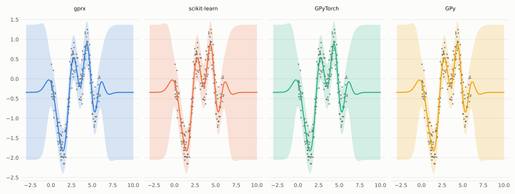
<!-- bench:end -->

### 1 次元の図

この 2 つの図には、Snelson の学習データ 200 点を使う。測定に使った CPU は Intel64 Family 6 Model 191 Stepping 2, GenuineIntel である。論理 CPU は 16 個、メモリは 47.8 GiB、OS は Windows-11-10.0.26200-SP0 だった。ライブラリの版は GPyTorch 1.15.2、GPy 1.14.2、torch 2.14.0、scipy 1.18.1、argmin 0.11.0、libgp f4a2fb7d である。

**Snelson のスパース GP**

誘導点は 8 個で、標準化した入力に k-means（シード 0）をかけて位置を選び、そのあとは動かさない。最適化器は表と同じく条件を揃えた L-BFGS で、反復は最大 100 回である。図にはスパース GP を持つライブラリ（gprx の `Sgpr`、GPyTorch、GPy）が 1 つずつ別の枠に並ぶ。どの枠でも、線は予測の平均、帯は 95% 区間、点は学習データを表す。薄い縦線は 8 個の誘導点の位置を示し、どの枠でも同じ位置にある。曲線は、Snelson のテスト入力の各点で予測した値から描いた。scikit-learn、libgp、friedrich はスパース GP を持たないので、この図には入っていない。`just perf-visual` はこの図を描くときに、尤度と勾配をまとめて計算した回数を表示する。今回は gprx が 64 回、GPyTorch が 45 回、GPy が 46 回で、この回数はコミットしていない。

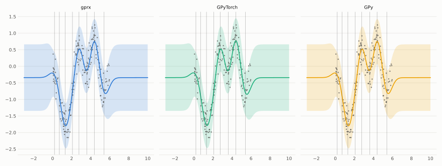

**Snelson の点の追加**

同じ学習点を、入力の小さいものから大きいものへ順に追加していく。ハイパーパラメータは学習させず、標準化した入力と目的変数のもとで、長さスケールを 1、信号の分散を 1、ノイズの分散を 0.1 にした。各フレームが表すのは、それまでに追加した点から求めた事後分布である。アニメーションにはそのうち 24 個の事後分布を収め、Snelson のテスト入力から等間隔に選んだ 160 点で予測して描いている。点の追加には、gprx が `OnlineGpr::insert`、libgp が `add_pattern`、GPyTorch が `get_fantasy_model` を使う。最後のフレームで 3 つの予測平均を比べると、標準化した目的変数の単位で、差の絶対値は最大でも 9.4e-14 だった。この値は `just perf-visual` がアニメーションを描くときに表示するもので、コミットはしていない。GPy と scikit-learn には学習点を追加する操作がない。friedrich はカーネルがこの比較の RBF と違うため、図に入れていない。

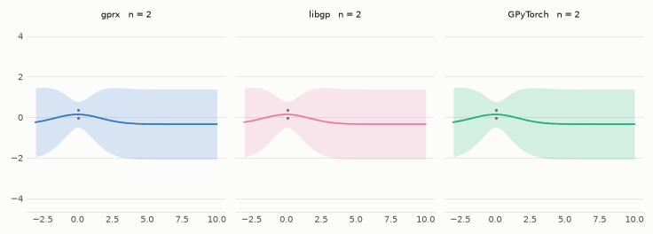

### 再現

```text
just perf-real-full                                            # 上の比較を取り、この節を作り直す
just perf-visual                                               # 上の Snelson の 2 つの図を作る
```

`just perf-real` に `--timeline` をつけて実行すると、プロセス全体の常駐メモリを 10 ms ごとに記録する。生の出力は `compare/perf/out/real/` に残るが、コミットはしない。表の数値、測定に使った PC、ライブラリの版、最適化器の設定は `docs/bench/summary.json` にまとめてある。詳しくは [`compare/perf/README.md`](https://github.com/YUKIKEDA/gprx/blob/main/compare/perf/README.md) を参照。
